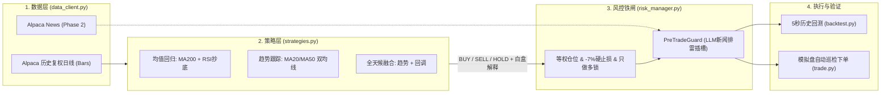

# 🛩️ Alpaca Swing Pilot

**面向程序员的美股/ETF 日线自动化波段交易代理（Long-Only 规则量化 + 风控铁闸 + 可插拔 LLM 新闻过滤）**

> **设计理念**：不训练黑盒深度学习模型，不碰高风险期权/期货，不触发美股 $25,000 日内交易（PDT）限制。用 **100% 白盒可解释的经典量化规则** 捕捉日线级别的“牛市急跌抄底（均值回归）”与“主升浪顺势跟随（趋势跟踪）”，由独立风控模块执行硬止损与仓位管理，并为 LLM 新闻排雷预留标准守门员接口。

---

## ✨ 核心特性

1. **零 PDT 规则烦恼（Daily Swing Trading）**
   * 基于美股日线（Daily Bars）隔夜波段交易，完美避开美股小资金账户 `< $25,000` 连续 5 日最多 3 次日内交易（Pattern Day Trader）的冻结限制。
2. **三大经典白盒策略开箱即用 (`swing_pilot/strategies.py`)**
   * **`rsi_pullback`（均值回归 · 低买高卖）**：只在股价处于 `MA200`（年线牛熊线）之上时，等待短期恐慌回调（`RSI(5) <= 30`）逢低买入，反弹至 `RSI(5) >= 68` 获利了结。
   * **`sma_cross`（趋势跟踪 · 顺势而为）**：基于 `MA20 / MA50` 双均线多头排列与动量确认，吃透科技股与大盘主升浪，均线死叉自动清仓逃顶。
   * **`hybrid`（全天候融合策略）**：结合趋势持仓与牛市急跌抄底双引擎。
3. **四道硬核风控铁闸 (`swing_pilot/risk_manager.py`)**
   * **只做多硬锁（Long-Only Guard）**：严禁融券做空，卖出数量在风控层与 API 驱动层双重校验 $\le$ 实际持仓股数。
   * **硬止损与移动止盈（Stop-Loss & Trailing Stop）**：单笔亏损达 `-7%` 或从持仓最高点回撤达 `-12%` 时，无视策略信号强制平仓保护本金。
   * **等权分散持仓**：默认精选高流动性大盘 ETF（`SPY`, `QQQ`）与科技龙头（`AAPL`, `MSFT`, `NVDA`, `GOOGL`, `AMZN`），单票上限 `20%`，最多同时持有 `5` 只。
   * **LLM 新闻守门员插槽（`PreTradeGuard`）**：为 Phase 2 接入 Alpaca News API + LLM 情绪排雷预留标准钩子，一票否决财报暴雷或重大诉讼标的。
4. **5 秒级本地历史回测引擎 (`backtest.py`)**
   * 无需傻等 30 个交易日，一键拉取过去 3~5 年真实除权复权（Split/Dividend Adjusted）历史日线，考虑买卖双边滑点（5 bps），几秒内输出与标普 500（`SPY`）死拿基准的全面对比报告。

---

## 🏗️ 系统架构



---

## 🚀 快速开始

### 1. 安装依赖

```bash
python3 -m venv .venv
source .venv/bin/activate
pip install -r requirements.txt
```

### 2. 配置 Alpaca Paper Trading 密钥

复制配置模板并填入你的 Alpaca 模拟盘密钥（`.env` 已被 `.gitignore` 严格忽略，绝不会泄露到 Git 仓库）：

```bash
cp .env.example .env
```

### 3. 运行 5 秒历史回测（对比三大策略 vs 标普500）

```bash
# 使用 Alpaca 真实历史行情回测过去 3 年表现
python backtest.py --years 3

# 若尚未配置 API Key，可随时使用离线合成行情模式体验
python backtest.py --offline
```

### 4. 运行每日行情扫描、LLM 新闻体检与模拟盘自动下单

```bash
# 安全预览模式 (Dry-Run)：扫描今日最新日线信号与风控建议，不实际发单
python trade.py --strategy hybrid

# 开启 Phase 2 本地 LLM 新闻守门员 + 全景新闻风险体检表
python trade.py --strategy hybrid --llm-audit --llm-guard

# 正式执行模式：将量化 + LLM 风控审核通过的订单提交至 Alpaca 模拟盘
python trade.py --strategy hybrid --llm-guard --execute

# 冒烟测试模式：立刻向 Alpaca 模拟盘下 1 股 SPY 测试买单，验证 API 链路
python trade.py --smoke-test
```

---

## 🗺️ 演进路线图 (Roadmap)

- [x] **Phase 1: 确定性量化骨架与回测/模拟交易闭环**
  - [x] `MA200 + RSI` 均值回归、`MA20/MA50` 趋势跟踪、全天候融合策略
  - [x] 四道风控铁闸（只做多锁、-8% 硬止损、-18% 移动止损、单票 20% 仓位上限）
  - [x] 多标的组合历史回测引擎（对比 `SPY` 基准收益与最大回撤）
  - [x] Alpaca Paper Trading 每日信号扫描与自动下单 CLI（带外部策略持仓自动隔离保护）
- [x] **Phase 2: LLM 新闻情绪与基本面暴雷守门员 (`swing_pilot/llm_guard.py`)**
  - [x] 接入 Alpaca News API 自动拉取标的池过去 72 小时实时英文财经新闻标题与摘要
  - [x] 对接本地 OpenAI 兼容大模型接口（如 `http://localhost:11435/v1` 上的 `qwen3.8-flash-next`），内置指数退避重试防多 Agent 并发排队冲突，实现“量化踩油门、LLM 踩刹车”
- [ ] **Phase 3: 自动化定时调度与通知推送**
  - [ ] 支持每日美股收盘前 15 分钟或收盘后自动巡检与 Telegram / Discord / 邮件日报推送

---

## ⚠️ 免责声明 (Disclaimer)

本项目仅供量化交易工程学习与模拟盘（Paper Trading）研究使用，不构成任何投资建议。股市有风险，实盘交易前请务必在模拟盘经过充分验证。
